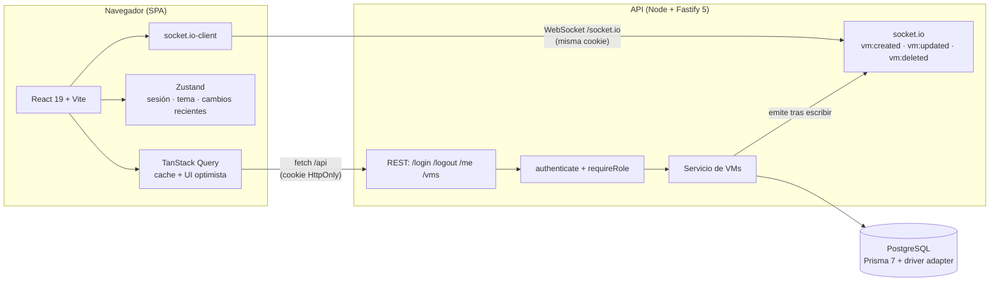

# IFX VM Manager — Prueba técnica IFX Full Stack

SPA pulida y responsiva para gestionar máquinas virtuales, con una API REST de soporte centrada
en seguridad y actualizaciones en tiempo real.

| Capa     | Tecnología                                                                            |
| -------- | ------------------------------------------------------------------------------------- |
| Monorepo | pnpm workspaces · Node 22+                                                            |
| Frontend | React 19 · Vite 8 · TypeScript · Tailwind 4 · TanStack Query · Zustand · React Router |
| Backend  | Fastify 5 · Prisma 7 (PostgreSQL) · zod · JWT en cookie · socket.io                   |
| Tests    | vitest (API con `fastify.inject`, componentes con Testing Library)                    |

## Demo rápida

```bash
pnpm install
pnpm db:up
pnpm db:migrate
pnpm db:seed
pnpm dev
```

- Web: <http://localhost:5173>
- API: <http://localhost:3000> (el front la consume vía el proxy `/api`)

| Rol    | Email             | Contraseña   |
| ------ | ----------------- | ------------ |
| ADMIN  | `admin@ifx.test`  | `Admin123!`  |
| CLIENT | `client@ifx.test` | `Client123!` |

## Requisitos

- **Node 22.18+** (la API usa el type-stripping nativo de TypeScript; se probó con Node 24).
- **pnpm 12** (el repo fija `packageManager: pnpm@12.11.2`; corepack lo descarga si hace falta).
- **Docker** con Compose (para PostgreSQL). Alternativa sin Docker: apunta `DATABASE_URL` a
  cualquier PostgreSQL (por ejemplo, Supabase como host; no se usa su cliente ni su Auth).

## Puesta en marcha paso a paso

1. **Instalar dependencias**

   ```bash
   pnpm install
   ```

   Al terminar, el `postinstall` de `apps/api` genera el cliente de Prisma
   (`apps/api/src/generated/prisma`, ignorado por git) y `apps/web` queda listo para Vite.

2. **Levantar PostgreSQL**

   ```bash
   pnpm db:up
   ```

   El contenedor expone **5433** en el host (en la máquina de desarrollo original ya había un
   PostgreSQL nativo en 5432; ver decisión D1-1). Si prefieres otro puerto, ajusta
   `docker-compose.yml` y `DATABASE_URL`.

3. **Aplicar migraciones y datos de prueba**

   ```bash
   pnpm db:migrate   # prisma migrate deploy + generate
   pnpm db:seed      # crea admin@ifx.test y client@ifx.test (idempotente)
   ```

4. **Arrancar todo en desarrollo**

   ```bash
   pnpm dev
   ```

   Levanta los tres paquetes en paralelo: `shared` en modo watch, la API en
   <http://localhost:3000> y la web en <http://localhost:5173>.

5. **Entrar** a <http://localhost:5173> con las credenciales de prueba.

### Variables de entorno (opcionales)

El flujo funciona **sin** crear ningún `.env` (hay valores por defecto de desarrollo). Si quieres
sobreescribirlos, copia `.env.example` a `apps/api/.env`; el script `ensure-env.mjs` también lo
crea automáticamente a partir del ejemplo la primera vez. En `NODE_ENV=production` la API exige
`DATABASE_URL` y `JWT_SECRET` explícitos y falla rápido si faltan.

### Notas de plataforma

- La cookie de sesión usa `Secure` **también en `http://localhost`**: Chrome y Firefox lo aceptan,
  pero **Safari puede no hacerlo**; si usas Safari en local, prueba con Chrome/Firefox o sirve la
  web por HTTPS.
- En Windows, `pnpm dev` deja los procesos en watch; ciérralos con `Ctrl+C` en la terminal donde
  corre.

## Scripts disponibles (raíz)

| Script                                            | Qué hace                                                   |
| ------------------------------------------------- | ---------------------------------------------------------- |
| `pnpm dev`                                        | Compila `shared` y levanta API + web (+ watch de `shared`) |
| `pnpm build`                                      | Compila todos los paquetes (`shared`, `api`, `web`)        |
| `pnpm test`                                       | Ejecuta la suite completa (54 tests)                       |
| `pnpm lint` / `pnpm format` / `pnpm format:check` | ESLint 10 (flat config, con tipos) y Prettier              |
| `pnpm typecheck`                                  | `tsc` estricto en todos los paquetes                       |
| `pnpm db:up` / `pnpm db:down`                     | Levanta/para el PostgreSQL de Docker Compose               |
| `pnpm db:migrate` / `pnpm db:seed`                | Migraciones y datos de prueba (Prisma)                     |

## Arquitectura

Diagrama completo (Mermaid) en [`docs/architecture.md`](docs/architecture.md):



En desarrollo, Vite hace de proxy de `/api` y `/socket.io` hacia la API, así front y API comparten
origen y la cookie `SameSite=Strict` funciona sin CORS.

### API REST

| Método | Ruta       | Acceso         | Notas                                                                |
| ------ | ---------- | -------------- | -------------------------------------------------------------------- |
| POST   | `/login`   | público        | Setea la cookie. La respuesta solo lleva `{ user }` (nunca el token) |
| POST   | `/logout`  | autenticado    | Limpia la cookie                                                     |
| GET    | `/me`      | autenticado    | Restaura la sesión en el front                                       |
| GET    | `/vms`     | ADMIN y CLIENT | `{ vms: [...] }`                                                     |
| POST   | `/vms`     | ADMIN          | `201` con `{ vm }`; `status` por defecto `STOPPED`                   |
| PUT    | `/vms/:id` | ADMIN          | **Actualización parcial** (cualquier subconjunto de campos)          |
| DELETE | `/vms/:id` | ADMIN          | `204`                                                                |

Errores uniformes: `{ "error": { "code", "message", "details"? } }` con códigos correctos
(`400`, `401`, `403`, `404`, `409` en nombre duplicado, `413`, `415`, `429`). La validación vive
en `packages/shared` (zod) y se reutiliza en el front.

### Seguridad

- JWT firmado (1 h) guardado **solo** en cookie `HttpOnly; Secure; SameSite=Strict` (configurable
  con `COOKIE_SAMESITE`); nunca aparece en el body ni en `localStorage`/`sessionStorage`.
- Autorización siempre en el servidor (`authenticate` + `requireRole('ADMIN')`); ocultar botones
  en la UI es solo UX.
- Login con mensaje genérico, rate limit estricto, comparación de hash en tiempo constante y
  hash dummy para emails inexistentes.
- CSRF: `SameSite=Strict` + `Content-Type: application/json` obligatorio en mutaciones (415 si no).
- CORS restrictivo, helmet, límite de body de 64 KB, logs con pino redactando cookies y
  `authorization`, y sin stack traces en respuestas de producción.

### Tiempo real

- socket.io sobre el mismo servidor HTTP de Fastify; la autenticación del socket lee la cookie del
  handshake y verifica el JWT (nada de token en query string).
- Los eventos `vm:created`, `vm:updated` y `vm:deleted` se emiten desde el servicio **después** de
  confirmar la escritura; el cliente actualiza el cache de TanStack Query y resalta la tarjeta
  ~1.5 s (idempotente: el originador del cambio no ve doble animación).

### Frontend

- Rutas: `/login` (pública), `/` (dashboard de recursos de VMs encendidas), `/vms` (listado con
  búsqueda y filtro) y `/vms/new` · `/vms/:id/edit` (solo ADMIN; un CLIENT que entre por URL es
  redirigido).
- Roles en UI: `<Can role="ADMIN">` / `useCan()`; un CLIENT no ve crear, editar ni eliminar.
- UI optimista con rollback en crear/editar/eliminar (id temporal `temp-<uuid>` que se reemplaza
  al confirmar), toasts (sonner) y diálogo de confirmación al eliminar.
- Dark mode nativo (script inline sin parpadeo, respeta `prefers-color-scheme` y persiste la
  preferencia) con un sistema de diseño inspirado en las HIG de Apple: tokens CSS mapeados a
  Tailwind, tipografía con jerarquía, vidrio esmerilado, movimiento sutil y
  `prefers-reduced-motion` respetado.
- El bundle se divide con `React.lazy` + `Suspense` y grupos de `codeSplitting` (Recharts solo se
  descarga al abrir el dashboard).

## Tests

```bash
pnpm test   # 54 tests: 13 shared + 17 API + 24 web
```

- **API** (vitest + `fastify.inject`): auth (cookie, 401 genérico, rate limit, CSRF), permisos por
  rol, CRUD y realtime (socket.io-client real contra el servidor).
- **Web** (Testing Library + jsdom): guards, formulario de login, rollback del optimistic UI,
  visibilidad por rol, resaltado y estadísticas del dashboard.
- Los tests de API usan una base aparte (`vmdb_test`) que se migra automáticamente al correr.

## Estructura del monorepo

```
.
├── AGENTS.md                  # Contexto y reglas del proyecto
├── README.md
├── docker-compose.yml         # PostgreSQL 17 (host: 5433)
├── pnpm-workspace.yaml
├── docs/
│   ├── AI_LOG.md              # Bitácora de IA (fuente de la sección de abajo)
│   ├── DECISIONS.md           # Decisiones arquitectónicas (D0-x a D7-x)
│   └── architecture.md        # Diagrama Mermaid
├── packages/
│   └── shared/                # Enums, tipos y esquemas zod compartidos
└── apps/
    ├── api/                   # Fastify + Prisma + socket.io
    │   ├── prisma/            # schema, migraciones y seed
    │   └── src/
    │       ├── config/        # env validado con zod
    │       ├── plugins/       # cookie, jwt, cors, helmet, rate-limit
    │       ├── modules/       # auth y vms (routes/service/repository)
    │       ├── middleware/    # authenticate, requireRole, CSRF
    │       ├── realtime/      # socket.io + emisión de eventos
    │       └── lib/           # errores y Prisma
    └── web/                   # React + Vite + Tailwind
        └── src/
            ├── app/           # providers, router, guards, layout
            ├── features/      # auth, vms, dashboard, realtime
            ├── components/    # UI genérica (Button, Card, Toggle, …)
            ├── lib/           # httpClient, queryClient, utils
            └── styles/        # tokens de diseño (CSS + Tailwind)
```

## Decisiones arquitectónicas

El detalle completo está en [`docs/DECISIONS.md`](docs/DECISIONS.md); resumen:

- **Prisma 7** con generador `prisma-client` + driver adapter `@prisma/adapter-pg`; cliente
  generado fuera de git y regenerado en `postinstall`/`db:migrate` (D1-4).
- **PostgreSQL en el puerto 5433** por conflicto con un servicio nativo en la máquina original
  (D1-1); Supabase vale como host cambiando `DATABASE_URL`.
- **TypeScript nativo de Node** en la API (sin `tsx`), con `tsc` para el build (D1-3).
- **CSRF** con `SameSite=Strict` + JSON obligatorio en mutaciones (D1-6).
- **UI optimista** con snapshot/rollback e id temporal (D4-2) y **realtime idempotente** por
  `updatedAt` (D6-3).
- **Bundle** dividido con `React.lazy` + `codeSplitting.groups` (D7-1): de un chunk de 933 KB con
  aviso a 24 chunks (el mayor, 312 KB).

## Limitaciones conocidas

- **Logout sin estado:** al cerrar sesión solo se limpia la cookie; el JWT sigue siendo válido
  hasta su expiración (1 h). Mejora futura: `tokenVersion` por usuario.
- **Rate limit en memoria:** con varias instancias de la API cada una limita por su cuenta; con
  escalado horizontal conviene un store compartido (por ejemplo Redis).
- **`trustProxy` desactivado:** correcto en local; al desplegar tras un proxy inverso hay que
  activarlo para que el rate limit vea la IP real.
- **`GET /vms` sin paginación:** suficiente a esta escala; si la lista creciera, cursor + índices
  (`status`, `createdAt`).
