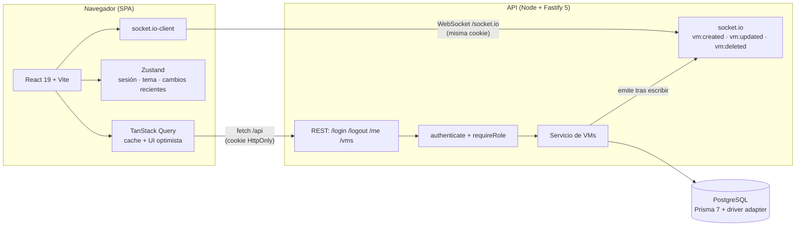

# IFX VM Manager — Prueba técnica IFX Full Stack

SPA pulida y responsiva para gestionar máquinas virtuales, con una API REST de soporte centrada
en seguridad y actualizaciones en tiempo real.

| Capa     | Tecnología                                                                            |
| -------- | ------------------------------------------------------------------------------------- |
| Monorepo | pnpm workspaces · Node 22+                                                            |
| Frontend | React 19 · Vite 8 · TypeScript · Tailwind 4 · TanStack Query · Zustand · React Router |
| Backend  | Fastify 5 · Prisma 7 (PostgreSQL) · zod · JWT en cookie · socket.io                   |
| Tests    | vitest (API con `fastify.inject`, componentes con Testing Library)                    |

## Demo rápida

```bash
pnpm install
pnpm db:up
pnpm db:migrate
pnpm db:seed
pnpm dev
```

- Web: <http://localhost:5173>
- API: <http://localhost:3000> (el front la consume vía el proxy `/api`)

| Rol    | Email             | Contraseña   |
| ------ | ----------------- | ------------ |
| ADMIN  | `admin@ifx.test`  | `Admin123!`  |
| CLIENT | `client@ifx.test` | `Client123!` |

## Requisitos

- **Node 22.18+** (la API usa el type-stripping nativo de TypeScript; se probó con Node 24).
- **pnpm 12** (el repo fija `packageManager: pnpm@12.11.2`; corepack lo descarga si hace falta).
- **Docker** con Compose (para PostgreSQL). Alternativa sin Docker: apunta `DATABASE_URL` a
  cualquier PostgreSQL (por ejemplo, Supabase como host; no se usa su cliente ni su Auth).

## Puesta en marcha paso a paso

1. **Instalar dependencias**

   ```bash
   pnpm install
   ```

   Al terminar, el `postinstall` de `apps/api` genera el cliente de Prisma
   (`apps/api/src/generated/prisma`, ignorado por git) y `apps/web` queda listo para Vite.

2. **Levantar PostgreSQL**

   ```bash
   pnpm db:up
   ```

   El contenedor expone **5433** en el host (en la máquina de desarrollo original ya había un
   PostgreSQL nativo en 5432; ver decisión D1-1). Si prefieres otro puerto, ajusta
   `docker-compose.yml` y `DATABASE_URL`.

3. **Aplicar migraciones y datos de prueba**

   ```bash
   pnpm db:migrate   # prisma migrate deploy + generate
   pnpm db:seed      # crea admin@ifx.test y client@ifx.test (idempotente)
   ```

4. **Arrancar todo en desarrollo**

   ```bash
   pnpm dev
   ```

   Levanta los tres paquetes en paralelo: `shared` en modo watch, la API en
   <http://localhost:3000> y la web en <http://localhost:5173>.

5. **Entrar** a <http://localhost:5173> con las credenciales de prueba.

### Variables de entorno (opcionales)

El flujo funciona **sin** crear ningún `.env` (hay valores por defecto de desarrollo). Si quieres
sobreescribirlos, copia `.env.example` a `apps/api/.env`; el script `ensure-env.mjs` también lo
crea automáticamente a partir del ejemplo la primera vez. En `NODE_ENV=production` la API exige
`DATABASE_URL` y `JWT_SECRET` explícitos y falla rápido si faltan.

### Notas de plataforma

- La cookie de sesión usa `Secure` **también en `http://localhost`**: Chrome y Firefox lo aceptan,
  pero **Safari puede no hacerlo**; si usas Safari en local, prueba con Chrome/Firefox o sirve la
  web por HTTPS.
- En Windows, `pnpm dev` deja los procesos en watch; ciérralos con `Ctrl+C` en la terminal donde
  corre.

## Scripts disponibles (raíz)

| Script                                            | Qué hace                                                   |
| ------------------------------------------------- | ---------------------------------------------------------- |
| `pnpm dev`                                        | Compila `shared` y levanta API + web (+ watch de `shared`) |
| `pnpm build`                                      | Compila todos los paquetes (`shared`, `api`, `web`)        |
| `pnpm test`                                       | Ejecuta la suite completa (54 tests)                       |
| `pnpm lint` / `pnpm format` / `pnpm format:check` | ESLint 10 (flat config, con tipos) y Prettier              |
| `pnpm typecheck`                                  | `tsc` estricto en todos los paquetes                       |
| `pnpm db:up` / `pnpm db:down`                     | Levanta/para el PostgreSQL de Docker Compose               |
| `pnpm db:migrate` / `pnpm db:seed`                | Migraciones y datos de prueba (Prisma)                     |

## Arquitectura

Diagrama completo (Mermaid) en [`docs/architecture.md`](docs/architecture.md):



En desarrollo, Vite hace de proxy de `/api` y `/socket.io` hacia la API, así front y API comparten
origen y la cookie `SameSite=Strict` funciona sin CORS.

### API REST

| Método | Ruta       | Acceso         | Notas                                                                |
| ------ | ---------- | -------------- | -------------------------------------------------------------------- |
| POST   | `/login`   | público        | Setea la cookie. La respuesta solo lleva `{ user }` (nunca el token) |
| POST   | `/logout`  | autenticado    | Limpia la cookie                                                     |
| GET    | `/me`      | autenticado    | Restaura la sesión en el front                                       |
| GET    | `/vms`     | ADMIN y CLIENT | `{ vms: [...] }`                                                     |
| POST   | `/vms`     | ADMIN          | `201` con `{ vm }`; `status` por defecto `STOPPED`                   |
| PUT    | `/vms/:id` | ADMIN          | **Actualización parcial** (cualquier subconjunto de campos)          |
| DELETE | `/vms/:id` | ADMIN          | `204`                                                                |

Errores uniformes: `{ "error": { "code", "message", "details"? } }` con códigos correctos
(`400`, `401`, `403`, `404`, `409` en nombre duplicado, `413`, `415`, `429`). La validación vive
en `packages/shared` (zod) y se reutiliza en el front.

### Seguridad

- JWT firmado (1 h) guardado **solo** en cookie `HttpOnly; Secure; SameSite=Strict` (configurable
  con `COOKIE_SAMESITE`); nunca aparece en el body ni en `localStorage`/`sessionStorage`.
- Autorización siempre en el servidor (`authenticate` + `requireRole('ADMIN')`); ocultar botones
  en la UI es solo UX.
- Login con mensaje genérico, rate limit estricto, comparación de hash en tiempo constante y
  hash dummy para emails inexistentes.
- CSRF: `SameSite=Strict` + `Content-Type: application/json` obligatorio en mutaciones (415 si no).
- CORS restrictivo, helmet, límite de body de 64 KB, logs con pino redactando cookies y
  `authorization`, y sin stack traces en respuestas de producción.

### Tiempo real

- socket.io sobre el mismo servidor HTTP de Fastify; la autenticación del socket lee la cookie del
  handshake y verifica el JWT (nada de token en query string).
- Los eventos `vm:created`, `vm:updated` y `vm:deleted` se emiten desde el servicio **después** de
  confirmar la escritura; el cliente actualiza el cache de TanStack Query y resalta la tarjeta
  ~1.5 s (idempotente: el originador del cambio no ve doble animación).

### Frontend

- Rutas: `/login` (pública), `/` (dashboard de recursos de VMs encendidas), `/vms` (listado con
  búsqueda y filtro) y `/vms/new` · `/vms/:id/edit` (solo ADMIN; un CLIENT que entre por URL es
  redirigido).
- Roles en UI: `<Can role="ADMIN">` / `useCan()`; un CLIENT no ve crear, editar ni eliminar.
- UI optimista con rollback en crear/editar/eliminar (id temporal `temp-<uuid>` que se reemplaza
  al confirmar), toasts (sonner) y diálogo de confirmación al eliminar.
- Dark mode nativo (script inline sin parpadeo, respeta `prefers-color-scheme` y persiste la
  preferencia) con un sistema de diseño inspirado en las HIG de Apple: tokens CSS mapeados a
  Tailwind, tipografía con jerarquía, vidrio esmerilado, movimiento sutil y
  `prefers-reduced-motion` respetado.
- El bundle se divide con `React.lazy` + `Suspense` y grupos de `codeSplitting` (Recharts solo se
  descarga al abrir el dashboard).

## Tests

```bash
pnpm test   # 54 tests: 13 shared + 17 API + 24 web
```

- **API** (vitest + `fastify.inject`): auth (cookie, 401 genérico, rate limit, CSRF), permisos por
  rol, CRUD y realtime (socket.io-client real contra el servidor).
- **Web** (Testing Library + jsdom): guards, formulario de login, rollback del optimistic UI,
  visibilidad por rol, resaltado y estadísticas del dashboard.
- Los tests de API usan una base aparte (`vmdb_test`) que se migra automáticamente al correr.

## Estructura del monorepo

```
.
├── AGENTS.md                  # Contexto y reglas del proyecto
├── README.md
├── docker-compose.yml         # PostgreSQL 17 (host: 5433)
├── pnpm-workspace.yaml
├── docs/
│   ├── AI_LOG.md              # Bitácora de IA (fuente de la sección de abajo)
│   ├── DECISIONS.md           # Decisiones arquitectónicas (D0-x a D7-x)
│   └── architecture.md        # Diagrama Mermaid
├── packages/
│   └── shared/                # Enums, tipos y esquemas zod compartidos
└── apps/
    ├── api/                   # Fastify + Prisma + socket.io
    │   ├── prisma/            # schema, migraciones y seed
    │   └── src/
    │       ├── config/        # env validado con zod
    │       ├── plugins/       # cookie, jwt, cors, helmet, rate-limit
    │       ├── modules/       # auth y vms (routes/service/repository)
    │       ├── middleware/    # authenticate, requireRole, CSRF
    │       ├── realtime/      # socket.io + emisión de eventos
    │       └── lib/           # errores y Prisma
    └── web/                   # React + Vite + Tailwind
        └── src/
            ├── app/           # providers, router, guards, layout
            ├── features/      # auth, vms, dashboard, realtime
            ├── components/    # UI genérica (Button, Card, Toggle, …)
            ├── lib/           # httpClient, queryClient, utils
            └── styles/        # tokens de diseño (CSS + Tailwind)
```

## Decisiones arquitectónicas

El detalle completo está en [`docs/DECISIONS.md`](docs/DECISIONS.md); resumen:

- **Prisma 7** con generador `prisma-client` + driver adapter `@prisma/adapter-pg`; cliente
  generado fuera de git y regenerado en `postinstall`/`db:migrate` (D1-4).
- **PostgreSQL en el puerto 5433** por conflicto con un servicio nativo en la máquina original
  (D1-1); Supabase vale como host cambiando `DATABASE_URL`.
- **TypeScript nativo de Node** en la API (sin `tsx`), con `tsc` para el build (D1-3).
- **CSRF** con `SameSite=Strict` + JSON obligatorio en mutaciones (D1-6).
- **UI optimista** con snapshot/rollback e id temporal (D4-2) y **realtime idempotente** por
  `updatedAt` (D6-3).
- **Bundle** dividido con `React.lazy` + `codeSplitting.groups` (D7-1): de un chunk de 933 KB con
  aviso a 24 chunks (el mayor, 312 KB).

## Bitácora de IA

Transcripción de [`docs/AI_LOG.md`](docs/AI_LOG.md) (el campo "Intervención de Carlos Eduardo" lo
completa él):

### Fase 0 — Andamiaje

- **Herramienta:** opencode + DeepSeek V4.1 Flash
- **Delegado a la IA:**
  - Configuración raíz del monorepo pnpm: `package.json` con scripts (`dev`, `build`,
    `typecheck`, `test`, `lint`, `format`, `db:up`, `db:down`, `db:migrate`, `db:seed`),
    `tsconfig.base.json` estricto (`strict`, `noUncheckedIndexedAccess`, `verbatimModuleSyntax`,
    etc.) y `pnpm-workspace.yaml` con `onlyBuiltDependencies` para Prisma y esbuild.
  - Tooling: ESLint 10 (flat config) con `typescript-eslint` en modo con tipos y Prettier.
    TypeScript quedó fijado en 6.0.3 porque `typescript-eslint` aún no soporta la línea 7.
  - `docker-compose.yml` con PostgreSQL 17 (volumen y healthcheck). Verificado con `pnpm db:up`
    (contenedor en estado `healthy`) y `pnpm db:down`.
  - `packages/shared`: enums (`Role`, `VmStatus`, `Os`), esquemas zod de VM (creación, actualización
    parcial y entidad) y de usuario público, y 11 tests de vitest. Compila a `dist/` con `tsc`.
  - `.env.example` (sección 10 de `AGENTS.md`) y `docs/DECISIONS.md` con las decisiones D0-1 a
    D0-7.
  - Verificación: `pnpm lint`, `pnpm typecheck`, `pnpm test` (11/11) y `pnpm build` en verde.
  - Nota: Prettier reformateó `docs/AGENTS.md` en la primera pasada; se restauró el original y se
    excluyó el archivo de Prettier (`.prettierignore`). El repositorio aún no está inicializado
    en git, así que no hay commits de esta fase.
- **Intervención de Carlos Eduardo (Intervención humana):**
- **Prompt clave (opcional):** «Lee AGENTS.md completo. Ejecuta únicamente la Fase 0 (andamiaje).
  Cuando termines, detente, resume qué creaste y agrega la entrada de la Fase 0 en docs/AI_LOG.md.
  No avances a la Fase 1.»

### Fase 1 — API base y auth

- **Herramienta:** opencode + DeepSeek V4.1 Flash
- **Delegado a la IA:**
  - Paquete `apps/api` (Fastify 5) ejecutado con el type-stripping nativo de Node (sin `tsx`),
    `tsconfig` estricto y build con `tsc`.
  - Prisma 7.10 (estable; el registro marca `8.0.0-rc.22` como "latest") con el generador
    `prisma-client` y `@prisma/adapter-pg`: schema (User, Vm, enums), migración inicial y seed
    idempotente con `admin@ifx.test` y `client@ifx.test` (bcryptjs).
  - Config de entorno con zod (defaults de desarrollo; en producción exige `DATABASE_URL` y
    `JWT_SECRET`), `.env.example` y script que crea `.env` a partir del ejemplo si falta.
  - `POST /login`, `POST /logout`, `GET /me`: cookie HttpOnly/Secure/SameSite (configurable),
    JWT de 1 h, rate limit estricto en login, mensaje de error genérico y comparación de hash en
    tiempo constante (hash dummy para emails inexistentes).
  - Plugins cookie/jwt/cors/helmet/rate-limit, `errorHandler` uniforme, exigencia de
    `application/json` en mutaciones y logger con redacción de cookies y `authorization`.
  - 15 tests de API (vitest + `fastify.inject`) contra `vmdb_test`, migrada automáticamente por
    el `globalSetup`.
  - Incidencias resueltas: un hook `preValidation` síncrono colgaba el ciclo de vida en Fastify
    v5 (los hooks deben ser `async` o llamar a `next`) y el `errorResponseBuilder` de rate-limit
    debe devolver un `Error` (se devuelve un `AppError` para conservar el formato uniforme);
    ambos casos quedaron comentados en el código. Además, un build fallido de prueba dejó `.js`
    obsoletos en `packages/shared/src` que rompían la resolución de Vite (se limpiaron y el
    build de la API ya no mapea a las fuentes de `shared`).
  - Ajustes de entorno: Postgres local pasa al puerto 5433 (había un PostgreSQL nativo en 5432)
    y la configuración de pnpm 12 migró `onlyBuiltDependencies` → `allowBuilds`.
- **Intervención de Carlos Eduardo (Intervención humana):**
- **Prompt clave (opcional):** «Pasa a la fase 2, ya inicialice git y ya movi manualmente
  agents.md a la raiz» (alcance confirmado: Fases 1 y 2 seguidas).

### Fase 2 — CRUD de VMs

- **Herramienta:** opencode + DeepSeek V4.1 Flash
- **Delegado a la IA:**
  - `GET /vms` (ADMIN y CLIENT) y `POST`/`PUT`/`DELETE /vms` (solo ADMIN) con validación zod de
    `packages/shared`, capas repository/service/routes y errores uniformes.
  - 409 en nombre duplicado (P2002 de Prisma), 404 en VM inexistente, 400 en id inválido y 403
    para CLIENT en mutaciones.
  - Tests de permisos y validación: CLIENT lista pero recibe 403 al mutar (y nada se escribe),
    duplicado 409, PUT parcial y validaciones 400 con `details`.
  - Verificación manual contra el servidor real: cookie con flags correctos, login sin token en
    el body y respuestas 403/409/415 esperadas.
- **Intervención de Carlos Eduardo (Intervención humana):**
- **Prompt clave (opcional):** — (mismo hilo que la Fase 1).

### Fase 3 — Frontend base

- **Herramienta:** opencode + DeepSeek V4.1 Flash
- **Delegado a la IA:**
  - `apps/web` (Vite 8 + React 19 + TypeScript) con el sistema de diseño de AGENTS.md, sección 9:
    tokens como variables CSS conmutables por tema y mapeados a Tailwind 4 (`@theme inline`),
    tipografía y radios fijos, sombras suaves (sin sombra en dark), barra con efecto vidrio y
    fallback sólido.
  - Dark mode por clase: script inline en `index.html` (sin parpadeo), respeta
    `prefers-color-scheme` en la primera visita y persiste la preferencia en `localStorage`.
  - `httpClient` único (fetch con `credentials: 'include'`), errores uniformes y 401 que limpia
    la sesión; store de sesión en Zustand y restauración con `GET /me` al arrancar (splash
    mientras carga).
  - Router (React Router 8) con `ProtectedRoute` (redirige a `/login` recordando el destino) y
    `AdminRoute` (un CLIENT que entre por URL a `/vms/new` es redirigido); la página de login
    redirige si ya hay sesión.
  - LoginPage con react-hook-form + zodResolver usando `loginSchema` de `packages/shared`,
    validación en tiempo real, botón deshabilitado si es inválido y error genérico del servidor.
  - Layout con barra superior (glass), navegación, toggle de tema y cerrar sesión; componentes
    propios (Button, TextInput, Card, EmptyState, Spinner, ThemeToggle, PageHeader) y
    placeholders de Dashboard/VMs/Formulario para las Fases 4 y 5.
  - 6 tests de componentes críticos (guards y formulario de login) con Testing Library + jsdom;
    la suite total del repo queda en 34 tests.
  - Smoke real con ambos servidores: SPA servida, proxy `/api` funcionando (401/200), login sin
    token en el body, CSRF 415 y tokens presentes en el CSS compilado.
  - Dependencias fuera de la tabla del stack (justificadas): `@tailwindcss/vite` (plugin oficial
    de Tailwind 4), Testing Library + jsdom (tests de componentes), `lucide-react` (íconos,
    indicado por la sección de diseño) y `eslint-plugin-react-hooks` (lint de hooks, en la raíz).
- **Intervención de Carlos Eduardo (Intervención humana):**
- **Prompt clave (opcional):** «Vamos a la fase 3».

### Fase 4 — VMs en el front

- **Herramienta:** opencode + DeepSeek V4.1 Flash
- **Delegado a la IA:**
  - Listado `/vms` con búsqueda por nombre, segmented control (Todas/Encendidas/Apagadas), grid
    responsive de tarjetas (1/2/3 columnas), skeletons durante la carga, empty state con CTA solo
    para ADMIN y estado "sin resultados" con limpiar filtros.
  - Formulario `/vms/new` y `/vms/:id/edit` con react-hook-form + `vmCreateSchema` compartido,
    validación en tiempo real (`onChange`), botón deshabilitado si es inválido, errores por campo
    y toggle iOS para el estado.
  - Mutaciones con UI optimista: crear inserta una VM temporal `temp-<uuid>` (atenuada, con
    spinner y acciones deshabilitadas) que se reemplaza al confirmar; editar y eliminar parchean
    el cache; `onError` restaura el snapshot y muestra toast; `onSettled` invalida.
  - `<Can role="ADMIN">` y `useCan()`: un CLIENT no ve crear, editar, eliminar ni el toggle.
  - Diálogo de confirmación antes de eliminar (fondo oscurecido + blur, Escape, estado pendiente)
    y toasts de éxito/error con sonner.
  - Componentes nuevos: Skeleton, SegmentedControl, Toggle, ConfirmDialog, Select y Can.
  - El formulario de edición lee la VM del cache del listado (la API no tiene `GET /vms/:id`).
  - 5 tests nuevos (rollback del optimista al crear/borrar, reemplazo del temporal, visibilidad
    por rol); la suite total queda en 39 tests.
  - Smoke con servidores reales vía el proxy de Vite: 201/200/409/400/204 y la base de datos
    queda limpia al final.
- **Intervención de Carlos Eduardo (Intervención humana):**
- **Prompt clave (opcional):** «Sigue con la siguiente fase».

### Fase 5 — Dashboard

- **Herramienta:** opencode + DeepSeek V4.1 Flash
- **Delegado a la IA:**
  - `/` muestra 4 tarjetas de resumen (VMs encendidas, vCPU, RAM y disco en uso) con la suma de
    los recursos de las VMs `RUNNING`, y tres gráficos Recharts de barras horizontales (vCPU
    azul, RAM verde, disco naranja) con esquinas redondeadas, sin cuadrícula y tooltip
    minimalista, siguiendo la sección de diseño de AGENTS.md.
  - El dashboard reutiliza la query de VMs (mismo cache que `/vms`) y calcula las sumas en una
    función pura (`summarizeVms`) cubierta por tests.
  - Estados completos: skeletons de tarjetas y gráficos durante la carga, empty state en dos
    variantes (sin VMs creadas / sin VMs encendidas) y error con reintentar.
  - 6 tests nuevos (3 de `summarizeVms` y 3 de `DashboardPage` con Recharts real en jsdom); la
    suite total queda en 45 tests.
  - Línea base del bundle para la Fase 7: el build queda en ~891 KB (267 KB gzip) con el aviso de
    chunks > 500 KB; la optimización se hará en el pulido, como se indicó en AGENTS.md.
- **Intervención de Carlos Eduardo (Intervención humana):**
- **Prompt clave (opcional):** «Siguiente fase».

### Fase 6 — Realtime

- **Herramienta:** opencode + DeepSeek V4.1 Flash
- **Delegado a la IA:**
  - socket.io 4.8 montado directamente sobre el servidor HTTP de Fastify (sin plugin intermedio,
    que no está en la lista del stack): la autenticación lee la cookie del handshake con
    `app.parseCookie` y verifica el JWT con `app.jwt.verify`; sin cookie o con token inválido la
    conexión se rechaza con `UNAUTHORIZED` (nada de token en query string).
  - Los eventos `vm:created`, `vm:updated` y `vm:deleted` (nombres compartidos en
    `packages/shared`) se emiten desde la capa de servicio, después de confirmar la escritura,
    con el payload de la VM serializado a ISO.
  - Cliente: singleton de socket en `features/realtime` y hook `useVmRealtime` montado en el
    layout autenticado; actualiza el cache de TanStack Query con `setQueryData` comparando
    `updatedAt` (idempotente: el originador no ve duplicados ni doble resaltado) y marca el id
    ~1.5 s en un store Zustand para el pulso.
  - Resaltado: animación CSS sutil de borde/fondo (1.5 s, curva suave) en la tarjeta, que respeta
    `prefers-reduced-motion` con la regla global de animaciones reducidas.
  - 9 tests nuevos: 2 de integración en la API con socket.io-client real (rechazo sin cookie y
    secuencia created/updated/deleted) y 7 en el front (store de cambios recientes, hook con
    socket simulado —inserción, actualización sin duplicar, eco ignorado y borrado— y resaltado
    de la tarjeta). La suite total queda en 54 tests.
  - Smoke real con el stack completo: cliente socket.io conectado **a través del proxy ws de
    Vite** (rechazo sin cookie, conexión autenticada y los tres eventos verificados).
  - Bundle tras la fase: 933 KB (281 KB gzip); sigue pendiente la optimización de la Fase 7.
- **Intervención de Carlos Eduardo (Intervención humana):**
- **Prompt clave (opcional):** «vamos con el siguiente paso».

### Fase 7 — Pulido y documentación

- **Herramienta:** opencode + DeepSeek V4.1 Flash
- **Delegado a la IA:**
  - Optimización de bundle: páginas con `React.lazy` + `Suspense` (fallback de skeletons) y
    separación de dependencias por grupos de `codeSplitting` (Rolldown, la API vigente en Vite 8)
    en `vite.config.ts`. Antes: un único chunk de 933 KB (281 KB gzip) con aviso de Vite.
    Después: 24 chunks, el mayor de 312 KB (98 KB gzip), páginas de 2–9 KB y Recharts
    descargándose solo al abrir el Dashboard; el aviso desaparece.
  - Accesibilidad: enlace "Saltar al contenido", landmark `main` también en el login y título de
    documento por página (`useDocumentTitle`).
  - `README.md` completo (guía paso a paso, credenciales, diagrama, decisiones resumidas,
    estructura de carpetas y la bitácora de IA) y `docs/architecture.md` con el diagrama Mermaid
    Cliente <-> API <-> WebSocket.
  - Verificación final: lint, typecheck, 54 tests, format y build en verde; smoke con el stack
    completo (SPA + login + /api/vms + módulos en dev) tras los cambios.
- **Intervención de Carlos Eduardo (Intervención humana):**
- **Prompt clave (opcional):** «Pasemos a la fase 7».

### Post-Fase 7 — Ajustes de la revisión de Carlos

- **Herramienta:** opencode + DeepSeek V4.1 Flash
- **Delegado a la IA:**
  - Mensajes de validación en inglés: al vaciar un input numérico zod mostraba
    "Invalid input: expected number, received NaN". Se añadieron mensajes base en español a los
    esquemas compartidos (`Introduce un número`, `El nombre es obligatorio`, enums y contraseña) y
    un test que los fija.
  - El formulario de crear/editar VM ahora es una **ventana modal** sobre el listado, con
    transición de entrada/salida (backdrop con blur, panel con escala/desplazamiento, 200/180 ms,
    respeta `prefers-reduced-motion`), cierre con Escape, clic en el fondo y botón X; las rutas
    `/vms/new` y `/vms/:id/edit` se mantienen (guard de ADMIN incluido) y el listado queda visible
    detrás. `ConfirmDialog` se refactorizó sobre el mismo componente `Modal` y también anima la
    salida al cancelar.
  - Cursores: Tailwind v4 no pone `pointer` en los botones (se restauró globalmente para botones y
    `role="button"`) y los controles deshabilitados ahora muestran `cursor-not-allowed` en lugar de
    bloquear el puntero (incluido el enlace de editar en VMs pendientes).
  - 4 tests nuevos (3 del modal — incluida la validación en español — y los mensajes de esquema);
    suite total: 58 tests. Build sin advertencias (25 chunks, el mayor 312 KB).
- **Intervención de Carlos Eduardo (Intervención humana):**
- **Prompt clave (opcional):** «Hay algunos fallos, cuando quito del input vCPU se ve el siguiente
  texto: nvalid input: expected number, received NaN, eso pasa con más inputs, al darle crear VM,
  me gustaría que funcionara más como una ventana modal con su respectiva transición, cuando paso
  el mouse sobre algunos botones no se ve bien el cursor pointer, cuando voy a crear una VM y se
  desactiva el botón por falta de datos debería aparecer el cursor-blocked de tailwind.»

### Marca IFX — nombre y sistema de diseño

- **Herramienta:** opencode + DeepSeek V4.1 Flash
- **Delegado a la IA:**
  - Tokens: `--accent` pasa al azul IFX (#0038E8 en claro / #3D6BFF en oscuro) y se añaden
    `--accent-violet`, `--accent-cyan` y `--brand-gradient`, mapeados a Tailwind (`@theme inline`).
  - Logo por tema (`ifx-logo.webp` / `ifx-logo-dark.webp`, según la clase `.dark`) en la pantalla
    de login y la barra superior, mostrado solo por altura (sin recolorear ni estirar); favicon con
    `ifx-mark.webp`.
  - El degradado de marca aparece únicamente como halo difuminado y sutil en el login.
  - Gráficos del dashboard: vCPU = azul IFX, RAM = violeta, disco = cian (semántica de estados
    intacta: verde encendida, gris apagada, rojo destructivo).
  - Nombre "IFX VM Manager" en el título de la pestaña, los títulos de página y el README.
  - Auditoría de colores: no quedaban azules del esquema anterior hardcodeados fuera de los tokens
    de `styles/index.css` (se reemplazaron ambos).
  - Verificación: lint, typecheck, 59 tests, format y build en verde (el build copia
    `public/brand/` y el favicon queda referenciado).
- **Intervención de Carlos Eduardo (Intervención humana):**
- **Prompt clave (opcional):** «Lee AGENTS.md, sección 9, bloque "Identidad de marca (IFX)", y la
  tabla de tokens actualizada. Los logos ya están en apps/web/public/brand/. Tarea: aplicar la
  identidad de marca.» (y «Cambia el nombre de la página por IFX VM Manager»).
