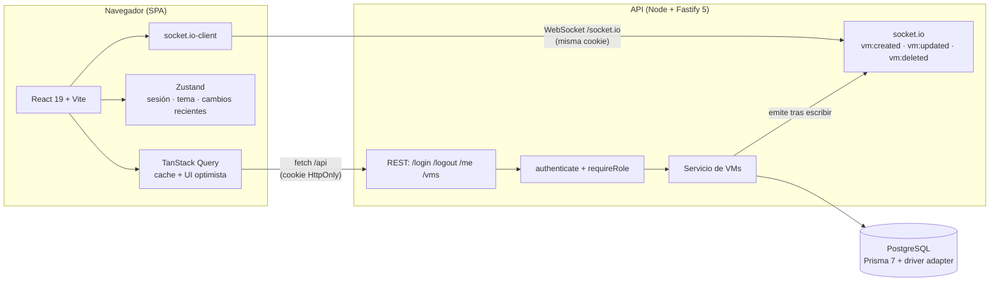

# Arquitectura — VM Manager

Vista general del sistema: cliente (SPA) ↔ API REST ↔ WebSocket ↔ PostgreSQL.

## Diagrama

En desarrollo, Vite hace de proxy de `/api` y `/socket.io` hacia la API (`http://localhost:3000`),
de modo que front y API comparten origen y la cookie `SameSite=Strict` funciona sin CORS.

## Flujo de autenticación

1. `POST /login` valida email/password con bcrypt (mensaje genérico y comparación en tiempo
   constante) y firma un JWT de 1 h.
2. El JWT viaja **solo** en una cookie `HttpOnly; Secure; SameSite=Strict` (configurable con
   `COOKIE_SAMESITE`); nunca aparece en el body ni en `localStorage`/`sessionStorage`.
3. El front no puede leer la cookie: restaura la sesión con `GET /me`.
4. El socket.io reutiliza la misma cookie en el handshake y verifica el JWT; sin token válido la
   conexión se rechaza (`UNAUTHORIZED`).

## Flujo en tiempo real

1. Las escrituras pasan por el servicio de VMs, que emite `vm:created`, `vm:updated` o
   `vm:deleted` **después** de confirmar la escritura en la base de datos.
2. El cliente aplica el evento al cache de TanStack Query (`setQueryData`) comparando `updatedAt`
   para ser idempotente (el originador del cambio no ve duplicados ni doble animación).
3. La tarjeta afectada se resalta con un pulso sutil de ~1.5 s (respeta
   `prefers-reduced-motion`).
